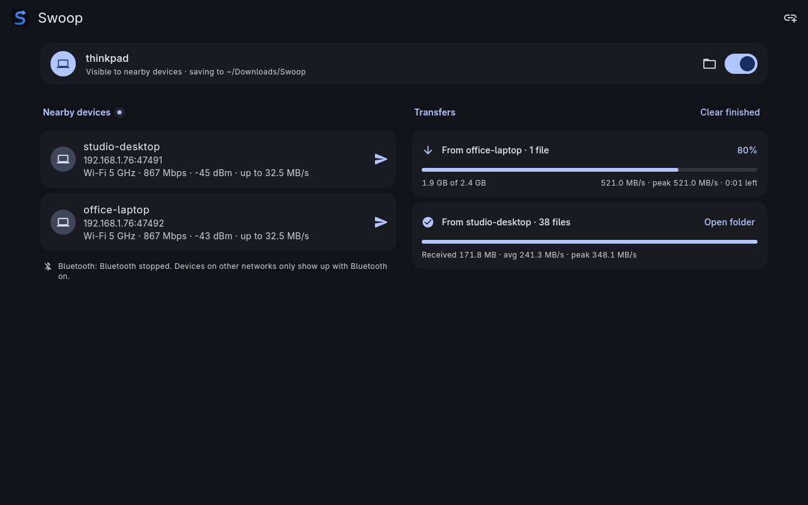
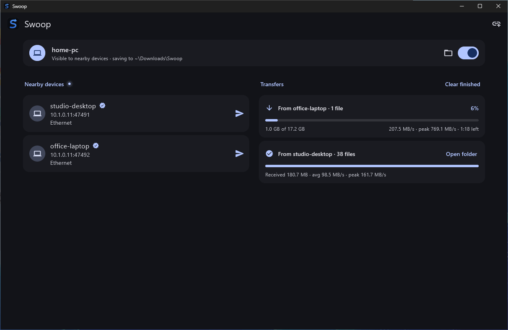
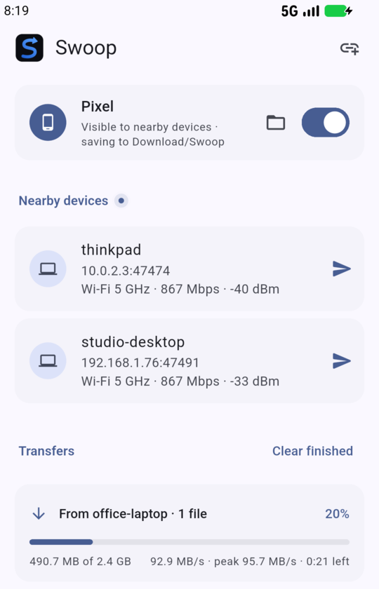
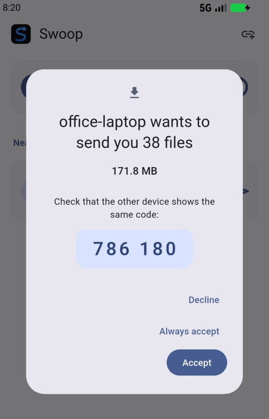

<p align="center">
  
</p>

<h1 align="center">Swoop</h1>

<p align="center">
  <b>Send files between Linux, Windows, macOS, Android and iOS at the full speed of your local network.</b><br>
  Offline. Zero setup. No accounts, no cloud, no cables.
</p>

<p align="center">
  <a href="https://github.com/anil0403/swoop/releases/latest"></a>
  
  <a href="LICENSE"></a>
</p>

<p align="center">
  <a href="#download">Download</a> ·
  <a href="#install">Install</a> ·
  <a href="#getting-started">Getting started</a> ·
  <a href="#command-line">Command line</a> ·
  <a href="#build-from-source">Build</a>
</p>

<p align="center">
  
</p>

<p align="center">
  
</p>

<p align="center">
  
  
</p>

---

## Why Swoop

Moving a few gigabytes between a phone and a laptop shouldn't mean a USB cable, a cloud upload or a chat app
that shrinks your videos. Open Swoop on both devices and they find each other on their own. Pick the files and
they go straight across your Wi-Fi, Ethernet or hotspot, encrypted end to end, at whatever speed the link can
carry.

## Features

| | |
|---|---|
| **Fast** | Parallel streams, a pipelined engine and hardware-accelerated encryption: the network is the limit, not Swoop. |
| **Zero setup** | Devices on the same network appear automatically. No IP addresses, no pairing menus, no settings. |
| **Works offline** | No internet needed. No shared network? Swoop sets up a direct Wi-Fi link between the two devices, found over Bluetooth. |
| **Private and secure** | TLS 1.3 with per-device keys. The first time a new device sends, both screens show the same 6-digit code to confirm. |
| **Resumes** | A dropped or cancelled transfer continues from where it stopped, with every chunk checked (BLAKE3). |
| **Any size, any number** | Single huge files or folders of thousands of small ones. Swoop checks free space before it starts. |
| **Fits in** | Android share sheet, drag and drop on Linux, Windows and macOS, a QR code for the phone camera, progress in the notification bar, photos straight into the Gallery. |
| **Light and dark** | A clean interface that follows your system theme, on phones and on wide desktop windows. |

## Supported systems

| Platform | Requirements | Builds |
|---|---|---|
| **Linux** | x86_64 or aarch64 (64-bit ARM), glibc 2.35+ (Ubuntu 22.04+, Debian 12+, Fedora 36+, Arch), GTK 3 | App + `swoop` command |
| **Windows** | Windows 10 or 11, x86_64 | App + `swoop` command |
| **macOS** | macOS 12 or newer, Apple silicon or Intel | App + `swoop` command |
| **iOS** | iPhone or iPad with iOS 15 or newer, sideloaded | App |
| **Android** | Android 8.0 or newer | App for 64-bit phones, and one for older 32-bit phones |
| **Termux** | 64-bit ARM phone | `swoop` command |

## Download

Direct links always point to the newest release. Every release also includes `SHA256SUMS` for checking the
downloads.

**Android**

| File | For |
|---|---|
| [**swoop-android.apk**](https://github.com/anil0403/swoop/releases/latest/download/swoop-android.apk) | Almost every phone (64-bit, about 2017 onward) |
| [swoop-android-armv7.apk](https://github.com/anil0403/swoop/releases/latest/download/swoop-android-armv7.apk) | Older 32-bit phones |

**Linux**

| File | x86_64 (most PCs) | aarch64 (ARM) |
|---|---|---|
| Archive: app + `swoop` command | [swoop-linux-x86_64.tar.gz](https://github.com/anil0403/swoop/releases/latest/download/swoop-linux-x86_64.tar.gz) | [swoop-linux-aarch64.tar.gz](https://github.com/anil0403/swoop/releases/latest/download/swoop-linux-aarch64.tar.gz) |
| AppImage | [swoop-x86_64.AppImage](https://github.com/anil0403/swoop/releases/latest/download/swoop-x86_64.AppImage) | [swoop-aarch64.AppImage](https://github.com/anil0403/swoop/releases/latest/download/swoop-aarch64.AppImage) |
| Flatpak | [swoop-x86_64.flatpak](https://github.com/anil0403/swoop/releases/latest/download/swoop-x86_64.flatpak) | |

**Windows:** [swoop-windows-x86_64.zip](https://github.com/anil0403/swoop/releases/latest/download/swoop-windows-x86_64.zip)
(app + `swoop` command, x86_64)

**macOS:** [swoop-macos.zip](https://github.com/anil0403/swoop/releases/latest/download/swoop-macos.zip)
(app + `swoop` command, Apple silicon and Intel)

**iOS:** [swoop-ios.ipa](https://github.com/anil0403/swoop/releases/latest/download/swoop-ios.ipa) (to sideload)

**Termux:** [swoop-android-aarch64.tar.gz](https://github.com/anil0403/swoop/releases/latest/download/swoop-android-aarch64.tar.gz)

All versions and betas: [Releases](https://github.com/anil0403/swoop/releases).

## Install

### Linux

**One line, no root.** Installs the app (in your app menu as Swoop, or run `swoop-app`) and the `swoop` command
into `~/.local`. Run it again to update.

```sh
mkdir -p ~/.local && curl -fsSL https://github.com/anil0403/swoop/releases/latest/download/swoop-linux-$(uname -m).tar.gz | tar -xz -C ~/.local
```

**AppImage**, nothing to install:

```sh
chmod +x swoop-x86_64.AppImage && ./swoop-x86_64.AppImage
```

**Flatpak** (x86_64):

```sh
flatpak install --user swoop-x86_64.flatpak
```

> The Flatpak can't create a direct Wi-Fi link from inside its sandbox. Use another format if your devices often
> share no network.

### Windows

1. Download [swoop-windows-x86_64.zip](https://github.com/anil0403/swoop/releases/latest/download/swoop-windows-x86_64.zip)
   and unzip it (right-click → **Extract All**).
2. Run `swoop-app.exe` from the unzipped folder. The `swoop` command (`swoop.exe`) is in the same folder; add the
   folder to your `PATH` to use it from any terminal.
3. On first start Windows asks whether to allow Swoop through the firewall. Allow it on **private networks**, or
   other devices can't find this one.

> The build isn't signed yet, so SmartScreen may warn about it: click **More info → Run anyway**.

> The direct Wi-Fi link and finding devices over Bluetooth aren't on Windows yet, so the devices need a shared
> network (Wi-Fi, Ethernet or a hotspot).

### macOS

1. Download [swoop-macos.zip](https://github.com/anil0403/swoop/releases/latest/download/swoop-macos.zip); Safari
   unzips it into Downloads.
2. Move **Swoop** to **Applications** and open it. The `swoop` command is next to it; move it into a folder on your
   `PATH`, such as `/usr/local/bin`, to use it from any terminal.
3. Allow Swoop to find devices on your local network when macOS asks.

> The app isn't signed by Apple yet, so macOS won't open it the first time. Open **System Settings → Privacy &
> Security** and click **Open Anyway** next to Swoop, or run `xattr -dr com.apple.quarantine /Applications/Swoop.app`.

> The direct Wi-Fi link and finding devices over Bluetooth aren't on macOS yet, so the devices need a shared
> network (Wi-Fi, Ethernet or a hotspot).

### iOS

Swoop isn't on the App Store, so the iPhone app is installed with a sideloading tool such as
[AltStore](https://altstore.io) or [Sideloadly](https://sideloadly.io), which signs it with your own Apple ID:

1. Download [swoop-ios.ipa](https://github.com/anil0403/swoop/releases/latest/download/swoop-ios.ipa).
2. Install it with the sideloading tool (with a free Apple ID, refresh it every 7 days).
3. Open Swoop and allow it to find devices on your local network.

> Received files are in the **Files** app, under **On My iPhone → Swoop**. Keep Swoop open while files transfer:
> the screen stays on, but iOS pauses apps in the background.

> The direct Wi-Fi link and finding devices over Bluetooth aren't on iOS. On a big network (larger than a /24),
> connect by address or with the QR code.

### Android

1. On the phone, open [swoop-android.apk](https://github.com/anil0403/swoop/releases/latest/download/swoop-android.apk)
   (or [the 32-bit one](https://github.com/anil0403/swoop/releases/latest/download/swoop-android-armv7.apk) on an
   old phone).
2. Allow your browser to install apps when Android asks, then tap **Install**.

Or from a computer, with `adb`:

```sh
curl -fsSLo swoop.apk https://github.com/anil0403/swoop/releases/latest/download/swoop-android.apk && adb install -r swoop.apk
```

> **Updating:** for now each release is signed with a different temporary key, so Android won't update over the
> old app. Uninstall the previous version first. Devices are paired again on first use.

### Termux

```sh
curl -fsSL https://github.com/anil0403/swoop/releases/latest/download/swoop-android-aarch64.tar.gz | tar -xz -C $PREFIX
```

Check any install with `swoop version`.

## Getting started

1. **Open Swoop on both devices.** On the same network they show up in each other's list within a few seconds.
2. **Send.** Tap the other device and pick files or a folder. On Linux, Windows and macOS you can also drop files onto
   the window; on Android, use **Share → Swoop** from any app. The first time you send to a device, Swoop shows its
   pairing code and sends nothing until you tap **Send**. After that the device is known and marked with a check. If
   another device shows up with the same name, it's flagged as *not the one you sent to before*. Tap the check
   (or long-press the device) to forget it.
3. **Accept.** The first time, both screens show the same 6-digit code. Check it matches and tap **Accept**, or
   **Always accept** to trust that device from now on. The code is new every time, so a code that doesn't match
   means someone else is answering: tap **Decline**. A device on Swoop 2.6.1 or older can't pair anymore,
   only send to devices that already trust it, so update both.
4. **Done.** Files land in `Downloads/Swoop` (Linux and macOS), `Downloads\Swoop` (Windows), `Download/Swoop`
   (Android, where photos and videos also appear in the Gallery) or **Files → On My iPhone → Swoop** (iOS).

**Devices don't see each other?** Guest Wi-Fi and some office networks block discovery. Tap the **link icon** at
the top of the app, then scan the QR code with the phone camera or type the address the other device shows.

**No shared network at all?** (Linux and Android) Turn on Bluetooth on both devices. Swoop finds the other device
over Bluetooth and connects the two with a direct Wi-Fi link.

**Not receiving?** Check the switch on the status card at the top. While it's off, Swoop turns down incoming
files.

### Getting the best speed

Swoop goes as fast as the link allows, so the network decides the speed:

- **Use 5 GHz Wi-Fi** (or 6 GHz). 2.4 GHz is several times slower.
- **Stay close to the router.** A weak signal means a slow link.
- **Plug the computer into the router with a cable.** Then only the phone uses Wi-Fi, which roughly doubles what
  two Wi-Fi devices get through the router.

After each transfer the card shows the size, the average speed and the peak speed.

## Command line

The `swoop` command comes with the Linux, Windows and macOS installs and works on its own: on servers, over SSH, or in
Termux.

```sh
swoop recv --dir ~/Downloads        # receive: nearby devices can now find this one
swoop scan                          # list devices that are receiving
swoop send phone-name photos/ a.mp4 # send to a device by name, fingerprint, address or swoop:// link
swoop bench --size 4G               # measure this machine's engine speed
```

`recv` prints a `swoop://` link to use when scanning can't reach. When an unknown device sends, both sides show
the same pairing code; answer `a` to always trust that device. The first `send` to a device asks you to check
its code too. A name that several devices answer to, or that now belongs to a different device, is refused.
Give the fingerprint or `swoop://` link instead, which also skips the question (useful in scripts).
`swoop known` lists the devices you sent to or trusted; `swoop forget NAME` forgets one.

## Build from source

<details>
<summary><b>Rust core and the <code>swoop</code> command</b> (Rust stable)</summary>

```sh
cd core
cargo build --release   # -> target/release/swoop
```

For Android (NDK from `$ANDROID_NDK_HOME`, `$ANDROID_NDK_LATEST_HOME` or the newest `~/Android/Sdk/ndk/*`):

```sh
rustup target add aarch64-linux-android
scripts/build-android.sh   # or: scripts/build-android.sh armv7-linux-androideabi x86_64-linux-android
```

To run a self-built `swoop` in Termux, copy it into Termux's `$HOME` first; binaries can't run from shared
storage:

```sh
adb push core/target/aarch64-linux-android/release/swoop /data/local/tmp/
# in Termux:
cp /data/local/tmp/swoop ~ && chmod +x ~/swoop && ~/swoop version
```

</details>

<details>
<summary><b>Linux app</b> (Flutter from <code>app/.flutter-version</code>, clang, cmake, ninja, GTK 3 headers)</summary>

```sh
cd app
flutter build linux --release   # -> build/linux/x64/release/bundle/swoop-app
./test-e2e.sh                   # full flow, app ↔ CLI in a network namespace (needs sudo and a display)
```

</details>

<details>
<summary><b>Windows app</b> (Flutter from <code>app/.flutter-version</code>, Visual Studio 2022 with "Desktop development with C++", Rust stable for MSVC)</summary>

```sh
cd app
flutter build windows --release   # -> build\windows\x64\runner\Release\swoop-app.exe
```

</details>

<details>
<summary><b>macOS and iOS apps</b> (a Mac with Xcode and CocoaPods, Flutter from <code>app/.flutter-version</code>, Rust stable)</summary>

```sh
rustup target add aarch64-apple-darwin x86_64-apple-darwin aarch64-apple-ios
cd app
flutter build macos --release             # -> build/macos/Build/Products/Release/Swoop.app
flutter build ios --release --no-codesign # -> build/ios/iphoneos/Runner.app, to sign and sideload
```

</details>

<details>
<summary><b>Android app</b> (also a JDK 17+ and the Android SDK, with <code>JAVA_HOME</code> set)</summary>

```sh
cd app
flutter build apk --release --split-per-abi   # -> build/app/outputs/flutter-apk/app-arm64-v8a-release.apk, …
emulator -avd NAME -no-window & ./test-android.sh   # full flow, app ↔ CLI (or a phone over adb)
```

</details>

## Project

- [PLAN.md](PLAN.md): design, architecture and progress.
- [VERSIONING.md](VERSIONING.md): how versions and releases are made from commit messages.
- **Status:** the engine, the command and both apps are working and released. Real-phone testing of every
  Android feature is in progress.

## License

[MIT](LICENSE) © anil0403
